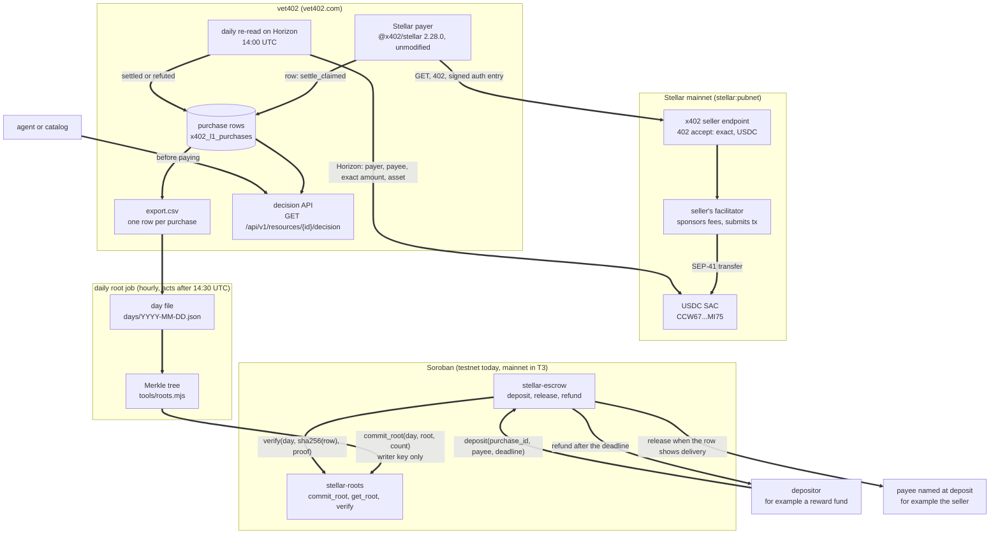
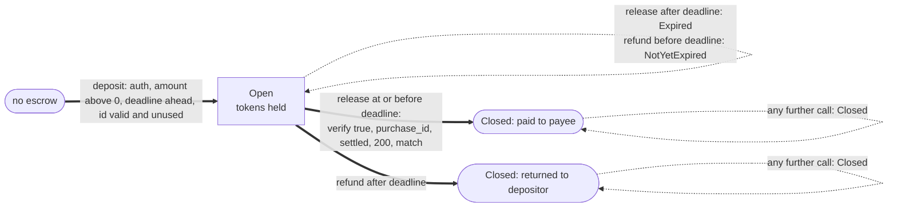

# vet402 on Stellar: technical architecture

Stellar Community Fund #46, Build Award, Open track. This document covers only the Stellar integration: the mainnet payer, the public record of its purchases, the two Soroban contracts and the work the award would fund. vet402 also buys on other chains, and none of that is described here.

Figures are as of 2026-10-21 23:23 UTC unless a line says otherwise. Live sources: https://vet402.com/observatory/state (the JSON behind it is https://vet402.com/api/v1/observatory/state) and every row at https://vet402.com/api/v1/observatory/export.csv.

## 1. Summary

### Built and running today

| Part | Network | State |
|-|-|-|
| x402 payer that buys from Stellar sellers in USDC | Stellar mainnet (`stellar:pubnet`) | live since 2026-10-18. 53 paid attempts across 4 hosts, 46 settled and 46 delivered (delivered means settled and the paid response was HTTP 2xx, and all 46 rows show HTTP 200 in the export) |
| One public row per purchase, with the Stellar transaction hash | vet402.com export | live |
| Daily Merkle root of the Stellar rows, committed to a Soroban contract | Stellar testnet | contract live since 2026-10-20. Roots for 2026-10-18, 2026-10-19 and 2026-10-20 are on chain |
| Escrow that pays a reward only when the committed row shows delivery | Stellar testnet | sample live since 2026-10-20, with one recorded release and one recorded refund |
| Decision API that answers "should my agent pay this endpoint?" | vet402.com | live, and it already answers from Stellar rows |

Two facts about the current state that a reviewer should know:

1. The decision API already reads Stellar rows. For the image-ocr listing on agent402.tools it answers `ALLOW`, and its `verified_terms` name `stellar:pubnet`, the payee `GDNJXCKW7ZM7GEEVP674TWPU26YJNBQ2FI4ZIPRKTPTNUEJMDHFJWWRL`, the USDC contract `CCW67TSZV3SSS2HXMBQ5JFGCKJNXKZM7UQUWUZPUTHXSTZLEO7SJMI75` and the purchase `stellar:pubnet:cf9599017134ce255dba5919734484983fbbbddec34fcdb38d0ec361463b3814` (read 2026-10-21 23:30 UTC).
2. The daily testnet commit job runs every hour. It was broken from 2026-10-21 15:11 UTC until 2026-10-21 23:16 UTC (2026-10-22 08:16 JST) because the job passed the `stellar` CLI options after the separator that starts the contract function's own arguments, so the CLI read them as contract arguments. The fix is commit `78f8ad15` with a regression test (`tests/stellar-roots-writer-call.test.ts`). The 2026-10-20 root was committed after the fix (15 rows, ledger 5320195). Consecutive committed testnet days are counted from 2026-10-22. Roots already on testnet are not the Tranche 3 count. Tranche 3 counts 30 consecutive UTC days on the mainnet v2 contract only.

### What the award adds

- Tranche 1: Stellar addresses, payee ids and transaction hashes become lookups in the resolve API, each Stellar settlement is tied to the nonce of the Soroban authorization entry vet402 signed, and a public tool rebuilds every day's root and checks it against the contract, with a daily coverage rate.
- Tranche 2: escrow v2 (testnet USDC, indexer events, no front run on a purchase id), root contract v2 (writer rotation and pause) with a threat model and monitoring plan, and an integration guide with a funder script.
- Tranche 3: root contract v2 on mainnet with 30 consecutive daily roots, escrow v2 frozen and submitted to the SCF audit, and public monitoring with full docs.

## 2. Architecture overview



The payer and the API run on vet402.com. The daily root job runs on the builder's machine and signs with a testnet identity held by the `stellar` CLI. The contracts hold no state about vet402 other than the roots and the escrows.

## 3. Component details

### 3.1 Stellar payer

Source: `src/lib/observatory/stellar402-payer.ts`, called from `src/lib/observatory/l1-runner.ts`.

- Discovery. Listings come from the public x402 catalog that vet402 reads (the CDP x402 Bazaar). A listing is a Stellar candidate when its 402 offers an `exact` accept on `stellar:pubnet` in Stellar USDC, either classic `USDC:GA5ZSEJYB37JRC5AVCIA5MOP4RHTM335X2KGX3IHOJAPP5RE34K4KZVN` or its SAC `CCW67TSZV3SSS2HXMBQ5JFGCKJNXKZM7UQUWUZPUTHXSTZLEO7SJMI75`. The network string must equal `stellar:pubnet` exactly. Testnet and other spellings are never chosen.
- Accept checks before any reservation. The payee must be a valid Stellar destination (`validateStellarDestinationAddress` from `@x402/stellar`). The amount must be a positive integer in stroops and a multiple of 10, because the row ledger keeps 6 decimals and Stellar USDC has 7. `extra.areFeesSponsored` must be `true`, which the unmodified `ExactStellarScheme` requires. `maxTimeoutSeconds`, when present, must be a positive integer.
- Limits. One purchase defaults to at most 1.00 USDC. `MAX_PER_PURCHASE_UNITS` defaults to 1,000,000 units. `OBSERVATORY_L1_MAX_PURCHASE_UNITS` may raise that ceiling, and a value above 25,000,000 units is ignored in favor of the default. Stellar has its own daily cap, 0.50 USDC by default (`L1_STELLAR_DAILY_CAP_USD`), and never above the shared daily budget. The lane runs only when `OBSERVATORY_STELLAR_L1_ENABLED` is exactly `"true"`. Without the secret, the Horizon URL or the Soroban RPC URL the lane is skipped.
- Signing. `createStellarPaymentPayload` builds the payment with the unmodified `ExactStellarScheme` and `createEd25519Signer` from `@x402/stellar` 2.28.0. The payer signs a Soroban authorization entry for the SEP-41 `transfer` on the USDC SAC. The authorization window is the seller's `maxTimeoutSeconds` clamped to 60 to 120 seconds. The seller's facilitator adds the fee, becomes the transaction source and submits it. The secret is read from the environment and is removed from every log and error.
- Recording. Each paid attempt becomes one row in `x402_l1_purchases`. A seller that answers with a well formed settlement receipt puts the row at `settle_claimed`. vet402 does not call a row `settled` on the seller's word.
- Re-read. The cron `/api/cron/verify-settlements` runs at 14:00 UTC (`vercel.json`). For Stellar it calls `verifyStellarSettlement` (`src/lib/observatory/settlement-verify-stellar.ts`), which reads Horizon directly. Horizon's network passphrase must be the public network's. The transaction must exist and be successful. Its operations and effects must contain a USDC move (classic or SAC) from the payer to the payee whose amount equals the signed amount in stroops exactly. A matching USDC move makes the row `settled`. A mismatch of payer, payee, amount or asset, a transaction with no USDC transfer, or a failed transaction makes the row `settle_claim_refuted`. A missing transaction, a Horizon passphrase other than the public network, a truncated page, or an unreadable response leaves the row at `settle_claimed` for the next run (`TRANSIENT_REASONS` in `src/lib/observatory/settlement-verifier.ts`).
- Evidence strength today. Stellar settled rows are published in the weaker tier, `amount_payee_only` (`src/lib/observatory/settled-tier.ts`). The runner stores `sha256(payload.transaction)` as `auth_nonce`, but the facilitator's fee changes the transaction, so the re-read cannot bind that value. The state page shows `settledNonceBound: 0` and `settledAmountPayeeOnly: 46` for `stellar:pubnet`. Tranche 1 Deliverable 2 closes this.

### 3.2 Row format and digest

The export (`src/app/api/v1/observatory/export.csv/route.ts`, columns in `src/lib/observatory/export-columns.ts`) has 19 columns: `attempted_at, resource_key, network, status, amount_units, spent_units, tx_hash, http_status_paid, latency_ms, l2_schema, held_reason, request_body, request_body_sha256, settlement_source, request_query, request_query_sha256, confirmed_units, purchase_id, l2_reading`. Columns are only ever added at the end. A row never contains the payer's key, the payee's address or the response body.

For the root, a row is a JSON object of those columns, every value a string exactly as the export prints it. The digest is

```
digest = sha256(canonical JSON of the row)
canonical JSON: keys sorted, no whitespace, values JSON encoded as strings
```

Example: purchase `1fb9b73c-09bc-4de7-879c-5bae20a41841` (agent402.tools domain-intel, 2026-10-19) has digest `4228da6218d13598d17c708926c3b1f7ba47c4e5c67b195988d4bcc09208a72d`. The canonical rows of the current export are at most 661 bytes.

### 3.3 Day file

`contracts/stellar-roots/tools/day.mjs` builds one UTC day from the export: every row whose `network` is `stellar:pubnet` and whose `attempted_at` falls on that date, sorted by `purchase_id`. It refuses an export whose records do not have the header's column count.

```json
{
  "date": "2026-10-19",
  "day": 20745,
  "count": 17,
  "root": "4d086a4ae9a2b202ac080cd136bbe4bdeda896dbc4fe5a536a5e12b739b23278",
  "source": "https://vet402.com/api/v1/observatory/export.csv",
  "rows": [ { "row": { "...": "19 string columns" }, "digest": "hex", "proof": ["hex", "..."] } ]
}
```

`day` is days since 1970-01-01 UTC. The export keeps changing (a `settle_claimed` row later becomes `settled`), so the day file is the record a root covers, not a later export. Published day files today: `contracts/stellar-roots/days/2026-10-18.json` (3 rows) and `2026-10-19.json` (17 rows). The 2026-10-20 root is on chain, and its day file is still on the job's machine (the job copies day files into the repository by hand). Tranche 1 Deliverable 3 publishes them automatically.

### 3.4 Merkle construction and proof format

Implemented twice, in Node (`tools/roots.mjs`) and in the contract (`src/lib.rs`), and the contract tests use vectors printed by the Node code.

```
leaf = sha256(0x00 || digest)
node = sha256(0x01 || min(a, b) || max(a, b))      byte order comparison
an odd node at the end of a level is carried up unchanged
```

- The 0x00 and 0x01 prefixes keep a leaf from being read as an inner node.
- Pairs are sorted, so a proof carries no left or right flags.
- A proof is the list of sibling hashes from the leaf up. A level where the node was carried up has no sibling and adds nothing. A one row day has an empty proof and its root is that row's leaf.
- A proof has at most ceil(log2(count)) entries. The 17 row day has proofs of at most 5 entries. Sixteen proofs have 5 entries. The last row's proof has 1 entry, because that odd node is carried up.

Anyone can rebuild a root from a day file with `tools/roots.mjs`. Rebuilding 2026-10-19 from its file gives `4d086a4ae9a2b202ac080cd136bbe4bdeda896dbc4fe5a536a5e12b739b23278`, the value `get_root` returns for day 20745.

### 3.5 Root contract (`contracts/stellar-roots`)

Testnet id `CCWWBZ2GBKDPRSUMT32CPB7LBUGHHKL37R5YNQC6RAWRV6PVIEKOBKRB`, writer `GDAUF55VCANOEOLIT547GRH2FEIALYIOWNUHSSGWSWWHVNO53V5DCJIW`, wasm sha256 `4ff8e33502298ebf9bc4e8434a6c74fce26f96b7a9bc14c193739207390b0c07` (built with Rust 1.99.1 and stellar-cli 28.1.0, the README has the commands to compare it with the deployed code).

```rust
fn __constructor(env: Env, writer: Address)
fn writer(env: Env) -> Address
fn commit_root(env: Env, day: u32, root: BytesN<32>, count: u32) -> Result<(), Error>
fn get_root(env: Env, day: u32) -> Option<DayRoot>          // DayRoot { root, count, ledger }
fn verify(env: Env, day: u32, digest: BytesN<32>, proof: Vec<BytesN<32>>) -> bool
```

- Auth. `commit_root` calls `writer.require_auth()`. The writer is set in the constructor and v1 has no function that changes it. `get_root`, `verify` and `writer` need no auth.
- Rules. `count` must be greater than 0 (`EmptyDay`). A day that already has a root is refused (`AlreadyCommitted`), so a root is never replaced. The contract does not compare `count` with the rows. The day file is where the count is checked.
- Storage. The writer is in instance storage. Each root is a persistent entry under `Root(day)`. A commit emits the event `("root", day)` with `(root, count)`. The contract holds no funds.
- `verify` returns false when the day has no root, folds the proof as in 3.4 and compares the result with the stored root.
- TTL. A commit gives the root and the instance about 30 days of ledgers (518,400 at 5 seconds, extended when less than half is left). The daily job then extends the instance, the wasm code and every committed root once per UTC day by 3,000,000 ledgers (about 180 days, capped by the network). Anyone can extend or restore an entry. An archived root or escrow entry makes the call that reads it fail until someone restores it. `verify` returns false only when the day has no root, or when the proof does not match the stored root.

### 3.6 Daily root job (`contracts/stellar-roots/tools/commit-day.sh`)

- A scheduler runs it every hour. Before 14:30 UTC it does nothing, because the settlement re-read runs at 14:00 UTC.
- It tries every day of the last 14, up to yesterday (UTC) and not before 2026-10-18, that is neither committed nor known to be empty. A day missed while the machine was off, or a day whose commit failed, is tried again on every run.
- The first try for a day fetches the export, writes the day file with `day.mjs`, and keeps that file as `pending`. A later try that already has a pending file commits that file and does not fetch the export again, so a row copied at `settle_claimed` stays that way in the day's root. Each try reads `get_root`, calls `commit_root` only when the day has no root, and reads the root back. A root on chain that differs from the day file stops the day, is not marked committed and is written to the job's alert file.
- It reads no secret files. The `stellar` CLI signs with its own testnet identity `vet402-roots-writer`.

### 3.7 Escrow (`contracts/stellar-escrow`)

Testnet id `CBWZJ6IF25ZCPBSEP4YGZOJL4MS43Q2QDWN7PWRDP6AQKOXEXURUS7BG`, reading the root contract above, wasm sha256 `48417bb9da0df0cdc1c95365ade45272ee856a14379b1ffa74bff896d73774b5`. The v1 sample uses testnet XLM.

Who deposits. A row that says `settled` means vet402 already paid the seller the price over x402. The deposit is a separate payment on top of the price, for example a fund that rewards Stellar sellers only for calls the record shows were delivered. In the code `buyer` is the depositor (refunded) and `seller` is the payee named at deposit (released to). The row names neither.

```rust
fn __constructor(env: Env, roots: Address)
fn deposit(env: Env, buyer: Address, token: Address, seller: Address,
           amount: i128, purchase_id: String, deadline_ledger: u32) -> Result<u64, Error>
fn release(env: Env, id: u64, day: u32, row: Bytes, proof: Vec<BytesN<32>>) -> Result<(), Error>
fn refund(env: Env, id: u64) -> Result<(), Error>
fn get(env: Env, id: u64) -> Option<Escrow>
fn roots(env: Env) -> Address
```

- `deposit` needs the depositor's auth. `amount` must be greater than 0. `deadline_ledger` must be after the current ledger. `purchase_id` must be 1 to 64 bytes of `[0-9a-z-]` (vet402 purchase ids are lowercase UUIDs). One escrow per `purchase_id`, including after it is closed. Emits `Deposit`.
- `release` can be called by anyone, at or before `deadline_ledger`. It hashes `row` with sha256, calls `roots.verify(day, digest, proof)`, then requires the exact byte sequences `"purchase_id":"<id>"`, `"status":"settled"`, `"http_status_paid":"200"` and `"l2_reading":"match"` in the row. It pays only the stored payee and emits `Release`.
- `refund` can be called by anyone after `deadline_ledger` while the escrow is open. It pays only the stored depositor and emits `Refund`.
- The escrow is marked closed before the token transfer, so a token that calls back cannot be paid twice. A failed transfer rolls the whole call back.
- The byte checks are sound because the row is canonical JSON of string values with sorted keys, no whitespace and escaped quotes, and the id alphabet cannot contain a quote. A row longer than 4,096 bytes never matches and can only be refunded.
- Storage. Escrows are persistent entries under `Escrow(id)` and `ByPurchase(purchase_id)`, extended by about 30 days of ledgers on deposit, release and refund.



### 3.8 Decision API

`GET /api/v1/resources/{resourceId}/decision?role=payer` (`src/app/api/v1/resources/[resourceId]/decision/route.ts`, spec in `docs/openapi.yaml`). `resourceId` is `sha256("<METHOD> <canonical url>")`, and `GET /api/v1/resolve?q=<url>` returns it. Calls without a key are answered at most 10 times per minute per IP.

The answer is `ALLOW`, `WARN` or `BLOCK` with the facts behind it: L0 liveness, the L1 purchases of the last 30 days, the L2 schema reading, and `verified_terms`, the network, payee, asset and amount of the last purchase vet402 saw delivered. `verified_terms.amount` uses 6 decimal ledger units and `decimals` is 6. A Stellar 402 amount is a 7 decimal stroop integer, so divide that amount by 10 before comparing it. Do not pay when network, payee or asset differs, or when the divided amount is above `verified_terms.amount`. For the image-ocr row, `verified_terms.amount` 10000 is 100000 stroops. The facts count every row of the listing, Stellar rows included, and the evidence links cite purchase ids of the form `stellar:pubnet:<tx hash>`.

What does not work for Stellar today is the lookup side. `GET /api/v1/resolve` classifies its query by shape (`src/lib/resolve/classify.ts`) and knows only EVM and base58 forms, so a Stellar G address, a payee id `stellar:pubnet:G...` and a Stellar transaction hash all return `invalid_query` (checked on vet402.com on 2026-10-21). Tranche 1 Deliverable 1 fixes that.

## 4. Security and trust model

### What the writer key can do

- Commit one root per UTC day that has no root yet, over any rows it chooses, with any `count` above 0.
- Commit a root for a day that never had a Stellar purchase, or for a future day number.

### What the writer key cannot do

- Replace or delete a committed root.
- Move any funds. The root contract holds none, and the escrow pays only the payee or the depositor stored at deposit.
- Change the escrow's root contract, which is fixed in the escrow's constructor.
- In v1, nothing (including the writer) can change the writer. That is a strength against a hijack and a weakness if the key is lost, which is why root contract v2 adds rotation.

### What a depositor trusts

- That vet402 published the true rows. A release is only as good as the record the writer key committed. The day files are published next to the contract so anyone can rebuild each root and compare it with `get_root`. A wrong root stays on chain forever and is visible.
- That `settled` means what section 3.1 says: vet402 re-read on Horizon a USDC transfer from its payer to the payee of the exact signed amount. Until Tranche 1 Deliverable 2 it does not prove that the transfer was the one for this purchase rather than an earlier transfer of the same amount to the same payee.
- That `http_status_paid` 200 and `l2_reading` match are vet402's own observations of the paid response.

### What is not trusted or not proven

- The seller's receipt. It moves a row only to `settle_claimed`.
- The facilitator. Its fee sponsorship changes the transaction hash, so nothing relies on that hash being known at signing time.
- A matching row does not prove the answer was correct, that anyone other than vet402 received it, or that the escrow amount relates to the price. The escrow does not compare `amount` with `amount_units`.
- The `count` in a root. The contract checks only that it is above 0.

### Failure modes

| Failure | Effect | Handling |
|-|-|-|
| Missed commit (machine off, RPC down, job bug as on 2026-10-21) | `verify` returns false for that day until it is committed | the job retries every uncommitted day of the last 14 on every hourly run and writes an alert. A deposit whose deadline passes first is refunded, never paid wrongly |
| Row still `settle_claimed` when its day is committed | that row can never release, because the root is fixed | the depositor is refunded after the deadline. The guide will advise deadlines well after the day's commit |
| Archived root or escrow entry | the call fails until the entry is restored | anyone can restore. The job extends roots, instance and code daily |
| Testnet reset | contracts and roots vanish | redeploy and recommit from the published day files, which do not change. The 2026-10-20 file is still only on the job machine, so that day cannot be recommitted from the repository until the file is published (T1 D3) |
| Writer key leaked | false roots for uncommitted days | v1 cannot rotate. v2 adds rotation and a pause of commits, and the threat model covers custody |
| Front run on a purchase id | anyone can deposit first for a `purchase_id`, and the real depositor then gets `DuplicatePurchase` | the squatter can only pay a payee of its own choosing or get its own deposit back. Escrow v2 removes the block |

## 5. Planned work by tranche

### Tranche 1

**D1. Stellar lookups in the resolve API.**
Design: add Stellar shapes to `classifyQuery`. A G address is a 56 character StrKey that passes the checksum, and a lookup returns the listings whose Stellar accept pays it. A payee id `stellar:pubnet:G...` is accepted next to the `eip155:` and `solana:` forms. A 64 character hex string without `0x` is looked up as a transaction hash among the Stellar rows (and among any other network whose hashes share that shape), and the answer names the network of each match. `ACCEPTED_QUERY_FORMS`, the `invalid_query` message and `docs/openapi.yaml` list the new forms.
Verified by: `GET /api/v1/resolve?q=` with the payee `GDNJXCKW7ZM7GEEVP674TWPU26YJNBQ2FI4ZIPRKTPTNUEJMDHFJWWRL`, with `stellar:pubnet:` plus that address, and with the hash of any settled Stellar row in the export each return the listing and its row instead of `invalid_query`.

**D2. Nonce bound Stellar settlements.**
Design: at signing, record the nonce of the Soroban authorization entry vet402 signed for the USDC `transfer`. The re-read fetches the transaction envelope, finds the authorization entry whose credentials address is the payer and whose root invocation is `transfer(payer, payee, amount)` on the USDC SAC, and requires that nonce, in addition to the existing checks on the USDC move. Soroban rejects a second use of the same nonce for the same address, so a match shows the transaction is the one vet402 authorized for this purchase. A mismatch refutes the row as other chains' nonce mismatches do. `settled-tier.ts` then puts these rows in `nonce_bound`. Rows settled before D2 keep the weaker tier, because vet402 does not demote a row on evidence it never held.
Verified by: on the state page, `settled` minus `settledNonceBound` for `stellar:pubnet` stays fixed at the number of Stellar rows settled before D2 ships (46 as of 2026-10-21), so every Stellar row settled after D2 is nonce bound. Unit tests cover a matching nonce, a different nonce, a different address and a missing authorization entry.

**D3. Root rebuild tool and coverage rate.**
Design: a public tool, next to `roots.mjs`, that takes the published day files, rebuilds each root and count, reads `get_root` for each day from the contract, and reports match, mismatch or missing per day. The job publishes each day file automatically once its root is on chain. A daily coverage rate is published. The denominator is the number of `stellar:pubnet` USDC `exact` listings with `areFeesSponsored` true that pass the payer accept checks (section 3.1) that day. The numerator is how many of those listings have a `stellar:pubnet` row in the export within the 30 UTC days ending that day. Both counts and the list of listings in the denominator are published with the rate.
Verified by: the rebuild tool matches every committed testnet root from 2026-10-18 on, and a third party can recompute the numerator from the export and check the denominator list against the catalog.

### Tranche 2

**D1. Escrow v2 on testnet.**
Design: testnet USDC instead of XLM. Events with the purchase id and the parties as topics so an indexer can follow an escrow from deposit to close. The `DuplicatePurchase` front run is removed by keying escrows by depositor and purchase id, so a deposit by one account can never block another account's deposit for the same purchase, while one depositor still has at most one escrow per purchase and a delivered row still cannot pay the same escrow twice.
Verified by: the testnet contract id, one recorded release and one recorded refund in testnet USDC, and a test where a second account's deposit for the same purchase id succeeds after a first account deposited.

**D2. Root contract v2, threat model and monitoring plan.**
Design: an admin address, intended to be a Stellar multisig account, can rotate the writer and pause new commits. Pause never stops `verify` or `get_root`, and committed roots stay immutable. Rotation and pause emit events. v2 also records a UTC day with no Stellar rows (count 0 with a fixed empty root), so every day has an entry and a missing entry always means a missed commit. The threat model covers the writer key and the escrow: custody of the writer key, rotation after a leak, the day file as the public check, deadlines against late commits, and the trust a depositor places in vet402's rows. The monitoring plan names each signal and its alert.
Verified by: the testnet contract id, a recorded rotation followed by a commit from the new writer that the old writer can no longer make, a recorded pause during which `verify` still answers, a recorded count 0 entry for one UTC day with no Stellar rows, and the published documents.

**D3. Integration guide and funder script.**
Design: a guide for a funder that wants to pay Stellar sellers a reward only for delivered calls, and an example script that deposits for a listing's purchase, waits for the day's root, fetches the row and proof from the day file and calls `release`, or calls `refund` after the deadline.
Verified by: the guide URL and a recorded testnet run of the script.

### Tranche 3

**D1. Root contract v2 on mainnet.**
Design: the v2 contract from T2 D2 deployed on mainnet with a mainnet writer, committing every UTC day, with `verify` open to any contract. The mainnet job writes each UTC day within 48 hours after that day ends. A day not committed within 48 hours of its end is not repaired by a later commit, and the 30 days count again from the next day.
Verified by: the mainnet contract id and a root committed on the mainnet v2 contract for each UTC day for 30 consecutive days, each within 48 hours of the end of its day, checked by the T1 D3 tool against the published day files. Testnet roots do not count toward the 30 days.

**D2. Escrow v2 audit ready and submitted to the SCF audit.**
Design: code freeze, the full test suite, an updated threat model, and submission to the SCF-provided audit. A mainnet escrow is deployed only after that audit and outside this award, because vet402 does not hold other people's funds before an independent audit.
Verified by: the frozen commit, the passing test run and the audit submission.

**D3. Public monitoring and docs.**
Design: public status for missed commits, the writer's XLM balance, failed `verify` calls and the escrow's token balance, and full docs for both contracts and the record.
Verified by: the monitor's public status URL and the docs URL.

## 6. Test plan

### Unit tests in the contracts (run on 2026-10-22 with Rust 1.99.1, all passing)

`contracts/stellar-roots` (7 tests): the writer commits once and the root reads back, a day cannot be committed twice, an empty day is refused, a non writer cannot commit, every row verifies with its proof from the Node implementation, a changed row or a wrong proof or another day does not verify, and a one row day verifies with an empty proof.

`contracts/stellar-escrow` (13 tests): the tree matches the roots reference vectors, the byte checks need the whole `"key":"value"` pair, release pays exactly the amount and then closes, release refuses a row that is not a delivered call, release refuses the wrong purchase or a bad proof or another day or a changed row, release and refund follow the deadline, deposit refuses a bad amount or a past deadline or a duplicate purchase, deposit needs the depositor's auth, quoted purchase ids are refused, one delivered row cannot pay two escrows, a row over the search limit does not match, and a key that only ends with a checked name does not count.

The daily job has a Node test for the argument order bug of 2026-10-21 (`tests/stellar-roots-writer-call.test.ts`).

### Testnet runs already recorded

| Run | Transaction |
|-|-|
| root for 2026-10-18 (3 rows) | https://stellar.expert/explorer/testnet/tx/49cd6604e0dc6a19acc79aee8e80aea8a6ebad7896f10333fb9c3d6964267e33 |
| root for 2026-10-19 (17 rows) | https://stellar.expert/explorer/testnet/tx/1df1de96620bc0208e8bd3989a3ee90ed87f4ed9955126c4a30c4ec01b401535 |
| root for 2026-10-20 (15 rows) | ledger 5320195, readable with `get_root` for day 20746 |
| deposit of 1 XLM for purchase `1fb9b73c-09bc-4de7-879c-5bae20a41841` | https://stellar.expert/explorer/testnet/tx/54f18e27f2f418ba2e65b41c1c36f3906faea50650a42c097199ca2a096639ab |
| release of that deposit with the row and proof from the 2026-10-19 day file | https://stellar.expert/explorer/testnet/tx/488eac7623d699f16f06964f3ba2f641a07ee712607e4e0ddbcdd8263630d7bc |
| deposit for a purchase whose row says `settle_failed`, then `release` refused with `NotDelivered` | https://stellar.expert/explorer/testnet/tx/375a34f263b86ea3186fd4c433b06c29a091974a8365d4465bee08b9ada44811 |
| refund of that deposit after the deadline | https://stellar.expert/explorer/testnet/tx/c9d167d83982b62bb091bc8ebee15b3aedde10b5524e3e8d923530c25911cde2 |

Read back on 2026-10-21 23:22 UTC: `get_root` for days 20744, 20745 and 20746 returns 3, 17 and 15 rows, `verify` for the first row of 2026-10-19 with its published proof returns true, and the escrow's `roots()` returns the root contract id.

### Tests per tranche

- T1 D1: classifier unit tests for each Stellar shape and for shapes that must stay `invalid_query` (a bad StrKey checksum, a C contract address where a G address is expected), and API tests against fixture rows.
- T1 D2: verifier tests with recorded Horizon responses for a matching nonce, a reused or different nonce, a different credentials address and a missing authorization entry, plus the tier test that fixes what `nonce_bound` means for `stellar:pubnet`.
- T1 D3: the rebuild tool run against every committed testnet day, and a test that a changed row in a day file is reported as a mismatch.
- T2 D1: the 13 escrow tests carried over to USDC, plus tests for two depositors on one purchase id, one depositor twice on one purchase id, and the event topics.
- T2 D2: tests that only the admin rotates and pauses, that the old writer fails after rotation, that a pause blocks `commit_root` and nothing else, that a committed root cannot be replaced in any state, and that a day with no rows is recorded as count 0 with the fixed empty root and cannot be committed again.
- T2 D3: the funder script run end to end on testnet, release and refund.
- T3 D1: the rebuild tool run daily against the mainnet contract for the 30 days.
- T3 D2: the full suite on the frozen commit and the audit's findings closed or answered.
- T3 D3: each monitor fired once on testnet by causing its condition (a skipped commit, a low writer balance, a failing verify).

## 7. Links

- Source (MIT): https://github.com/kzmttkc/vet402/tree/main/contracts
- Root contract README: https://github.com/kzmttkc/vet402/blob/main/contracts/stellar-roots/README.md
- Escrow README: https://github.com/kzmttkc/vet402/blob/main/contracts/stellar-escrow/README.md
- Who wrote and who checked the contracts: https://github.com/kzmttkc/vet402/blob/main/contracts/AI_USAGE.md
- Root contract on testnet: https://stellar.expert/explorer/testnet/contract/CCWWBZ2GBKDPRSUMT32CPB7LBUGHHKL37R5YNQC6RAWRV6PVIEKOBKRB
- Escrow on testnet: https://stellar.expert/explorer/testnet/contract/CBWZJ6IF25ZCPBSEP4YGZOJL4MS43Q2QDWN7PWRDP6AQKOXEXURUS7BG
- Example mainnet purchase: https://stellar.expert/explorer/public/tx/696f385519afc5474747c5c95d4d68d2d598faba53dfe349f6ba4cd6b118131e
- Live counts: https://vet402.com/observatory/state
- Every row: https://vet402.com/api/v1/observatory/export.csv
- API spec: https://vet402.com/openapi.yaml
